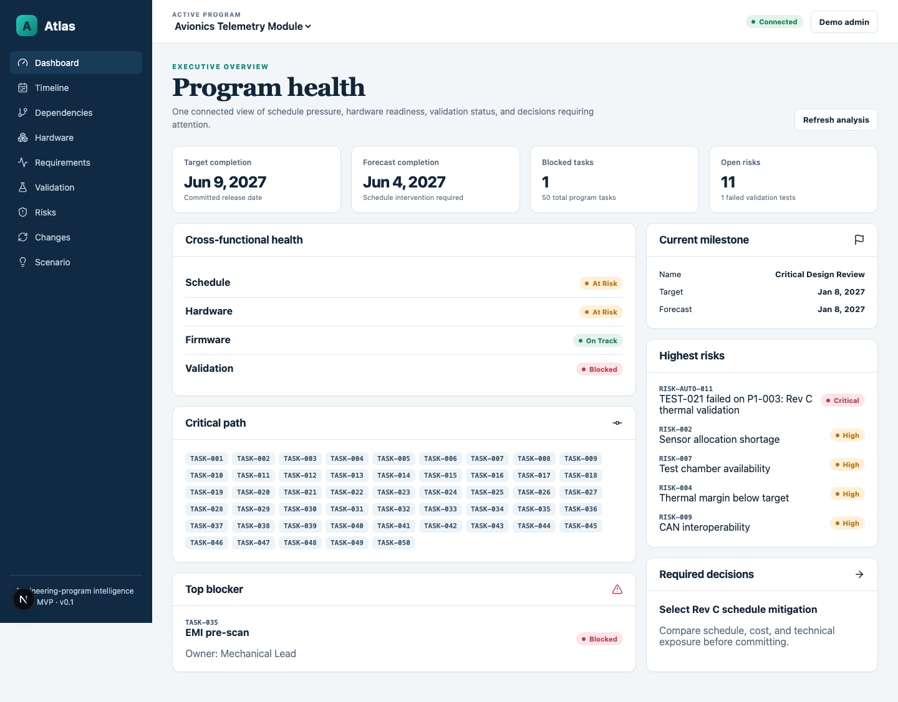
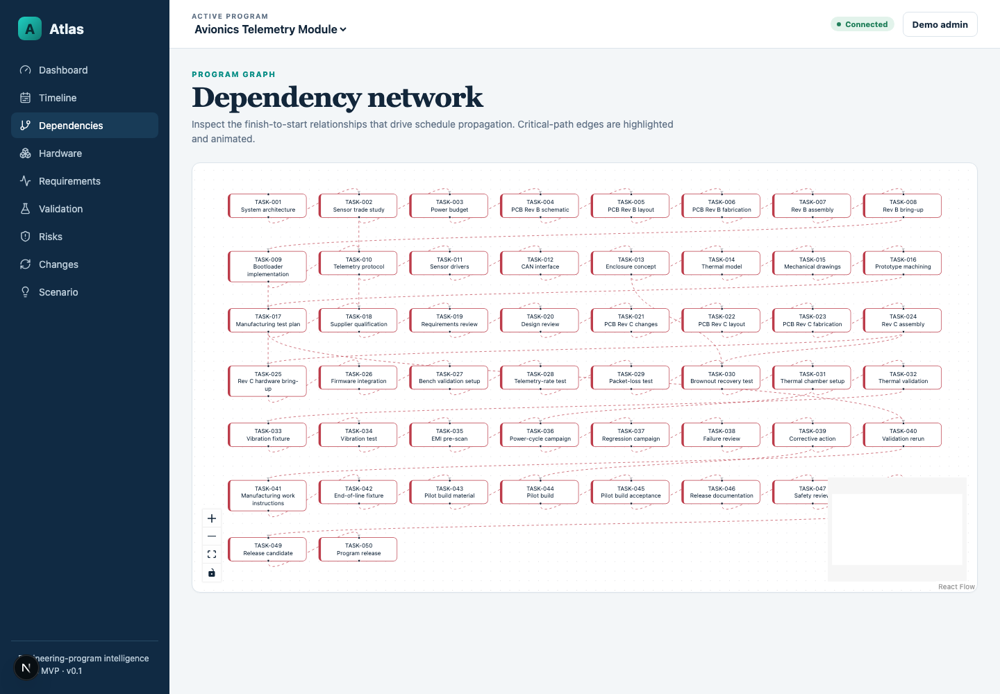
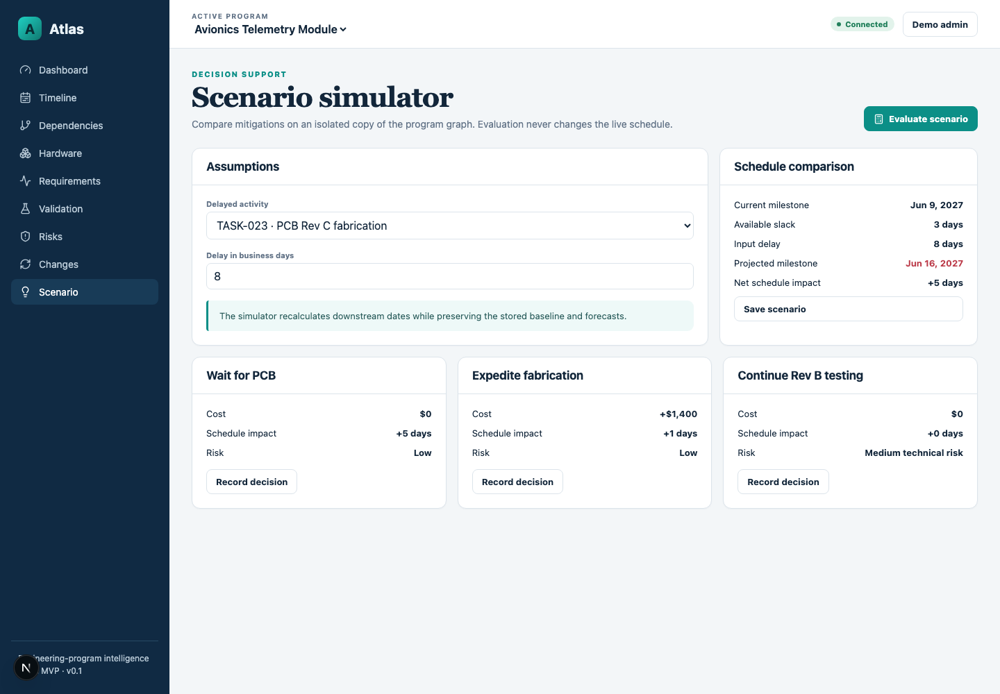
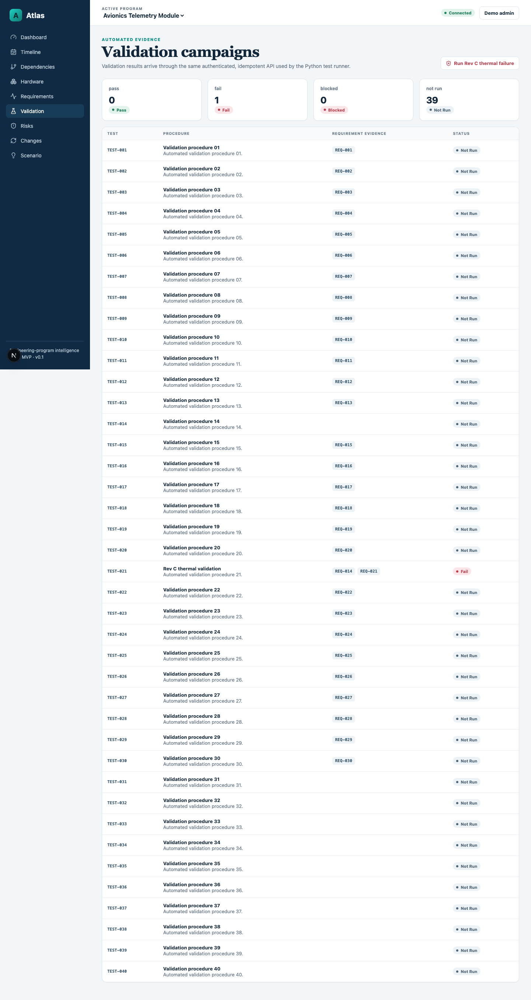
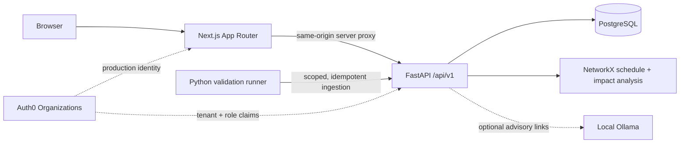

# Atlas

**Engineering-program intelligence for complex hardware development.**

[](https://github.com/Jaycoder7/Atlas/actions/workflows/ci.yml)
[](LICENSE)
[](apps/web)
[](apps/api)

[Live demo](https://atlas-jaycoder7.onrender.com) · [API documentation](https://atlas-api-jaycoder7.onrender.com/docs) · [Primary demo scenario](#primary-demo-scenario)

Atlas connects schedules, hardware revisions, prototype allocations, requirements, validation results, risks, and engineering changes in one explainable program graph. It helps a technical program manager answer: **what changed, what does it affect, what is now at risk, and what decision needs to be made?**



## Primary demo scenario

The seeded program models a six-team avionics telemetry module. Submitting one failed thermal-validation run for PCB Rev C atomically:

1. marks `TEST-021` as failed;
2. marks its linked requirement as failed;
3. flags prototype `P1-003`;
4. blocks the explicitly linked validation task;
5. creates or updates a source-linked program risk;
6. recalculates downstream schedule forecasts and critical-path state;
7. updates the projected milestone;
8. surfaces the blocker on the executive dashboard; and
9. enables comparison of cost, schedule, and technical-risk mitigations.

The test-run endpoint is idempotent, so retrying the same external run ID cannot duplicate results or risks.

| Connected schedule graph | Isolated scenario comparison |
| --- | --- |
|  |  |

<details>
<summary>Validation campaign after the thermal failure</summary>



</details>

## Architecture



The browser never receives an Auth0 access token. Next.js mediates API requests server-side, while FastAPI derives the tenant exclusively from the authenticated organization context. Deterministic schedule and impact analysis continues to work when the optional AI service is unavailable.

## What is implemented

- Nine responsive workspaces: dashboard, timeline, dependencies, hardware, requirements, validation, risks, changes, and scenario planning.
- Monday–Friday critical-path calculation with earliest/latest dates, slack, dependency paths, and milestone forecasts.
- Hardware availability, overlapping-allocation, revision-compatibility, and blocked-test warnings.
- Requirement state derived from the latest required validation evidence.
- Idempotent machine ingestion with automatic failure propagation and risk deduplication.
- Explainable engineering-change traversal over authoritative links and downstream dependencies.
- Non-destructive scenario evaluation and explicit decision recording.
- Organization-scoped repositories, role checks, M2M client mapping, and Auth0-ready token mediation.
- Deterministic seed data: 6 teams, 50 tasks, 30 requirements, 40 tests, 4 prototypes, 10 risks, and 5 engineering changes.

## Technology

| Layer | Stack |
| --- | --- |
| Web | Next.js, React, TypeScript, TanStack Query, React Flow |
| API | FastAPI, Pydantic, SQLAlchemy, Alembic |
| Analysis | NetworkX, Pandas, NumPy |
| Data | PostgreSQL; SQLite for isolated tests |
| Identity | Auth0 Organizations, organization roles, M2M scopes |
| Delivery | Docker Compose, Render Blueprint, GitHub Actions |
| Testing | Pytest, Vitest, Playwright |

## Run locally

Requirements: Docker Desktop and Docker Compose.

```bash
cp .env.example .env
docker compose up --build
```

Open [http://localhost:3000](http://localhost:3000). The API documentation is available at [http://localhost:8000/docs](http://localhost:8000/docs).

Demo mode is intentionally local-only and signs in as a seeded administrator. Trigger the main scenario from the Validation page or with:

```bash
python3 tools/test-runner/simulate.py thermal-failure
```

To enable optional local relationship suggestions:

```bash
docker compose --profile ai up --build
docker compose exec ollama ollama pull qwen2.5:7b-instruct
```

## Verification

```bash
# API unit and integration tests
cd apps/api && pytest

# Web unit tests, type checking, and production build
cd apps/web
npm ci
npm test
npm run typecheck
npm run build

# End-to-end product flow
npx playwright install chromium
npx playwright test
```

GitHub Actions runs backend lint/tests, frontend tests/type checking/build, and the Playwright thermal-failure smoke flow on every push and pull request.

## Deployment

[`render.yaml`](render.yaml) defines the Next.js web service, FastAPI service, and managed PostgreSQL database. The public portfolio deployment runs in demo mode with deterministic seed data. Production Auth0 setup is documented in [`docs/auth0-setup.md`](docs/auth0-setup.md).

Render's free services can cold-start after inactivity, and free PostgreSQL databases expire after 30 days. Those constraints are suitable for a portfolio preview but not a production environment.

## Design boundaries

Atlas is a focused MVP, not a Jira, PLM, or ERP replacement. V1 intentionally supports finish-to-start dependencies and a Monday–Friday calendar. Firmware, configurable holiday calendars, third-party imports, notifications, and granular per-program permissions remain outside the initial scope.

## License

MIT © 2026 Jaycoder7
